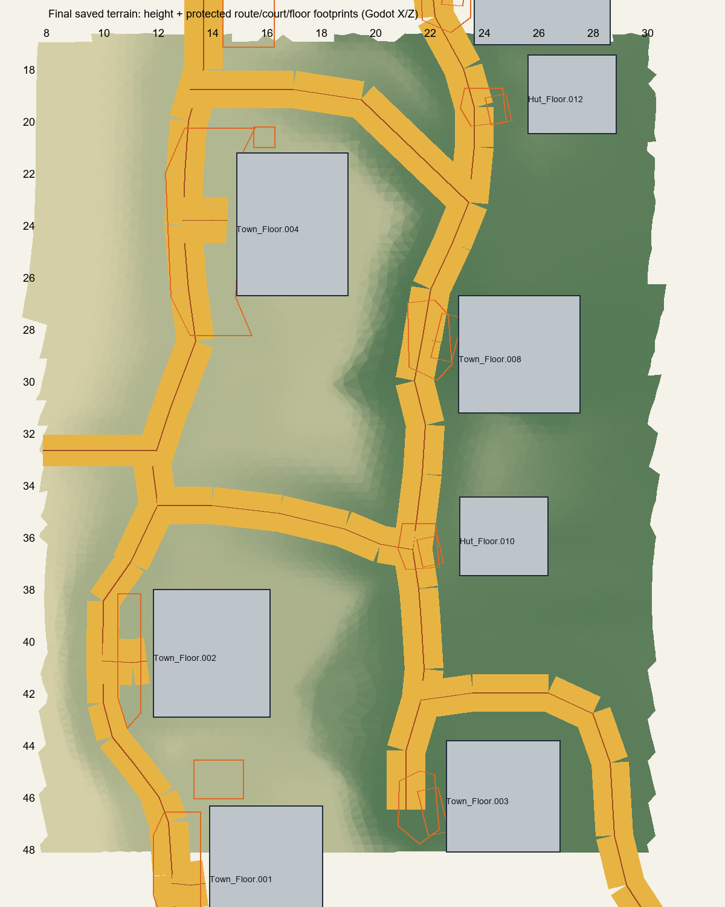
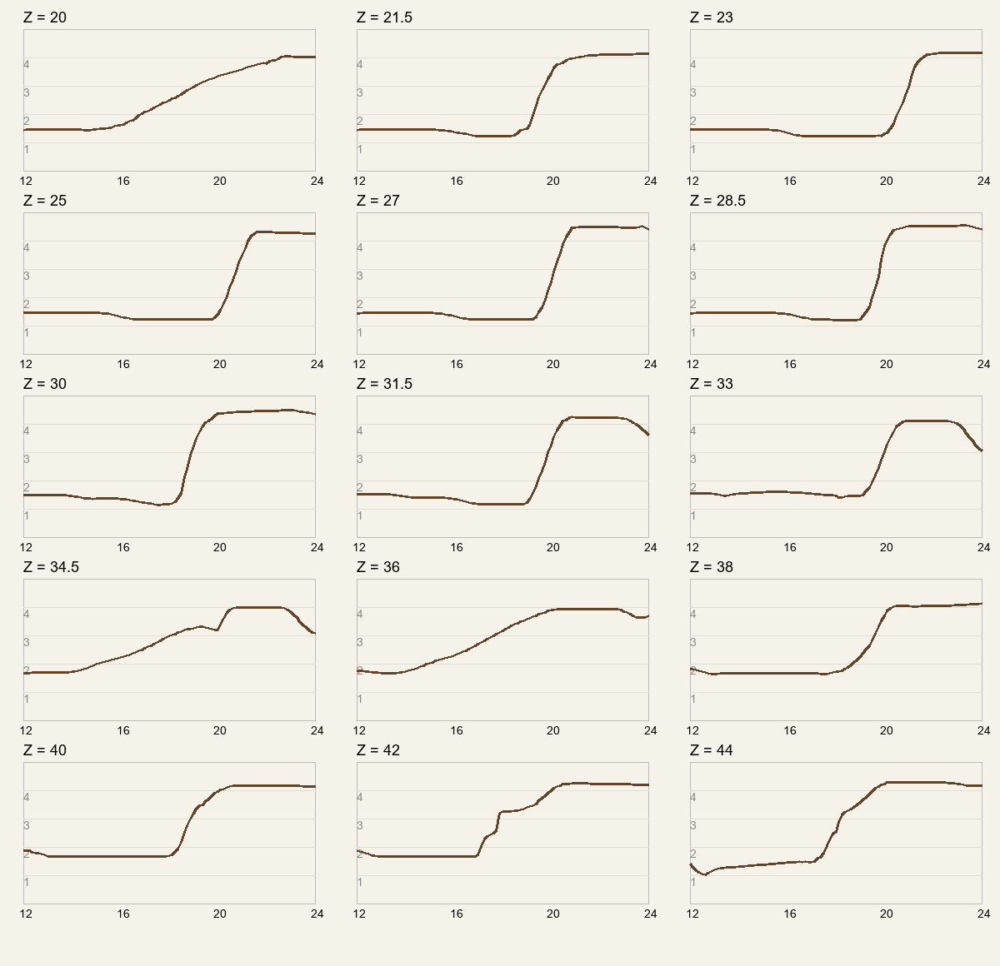

# 医院—Sea Breeze—酒吧岩体：只读几何方案

本方案只分析最终保存的 `terrain_structure_20261123/slope_cleanup.npz`、当前 `design.json`、楼板元数据和实机图，未连接 Blender，未修改运行资产。源身份为 `791081d9…`。控制点是拟议目标，不是已实施结果。

现有主要灰墙在 Godot X18–22、Z23–34，高程约1.15–4.53米；酒吧背后次段在 X17–21、Z38–44，高程约1.65–4.3米。15条真实横断面表明，大多数当前截面是单次圆滑S形跃升。例如Z28.5，X18为1.19米，X20为3.82米，X22为4.51米。单纯再加细纹或网格密度不能改变这个大形。

黄色表示现有道路实际全宽，橙线为院地边界，灰矩形为楼板世界AABB。该图的楼板范围用于定位，实际修改必须以live精确凸包及相交三角面保护；不能把AABB当最终碰撞精度。

建议分三组不等大的连续主体，而不是在整条灰墙外挂同样石块：

1. **Sea Breeze后侧Z23–27**：餐厅楼板到X19.03，后侧余地很窄，只整理转面与岩肩。坡冠由约X22向X20.7斜转，不能把巨大岩脚塞进楼后。
2. **医院前暴露段Z27.2–33.4**：作为主要体量，在Z29附近向海突出，坡脚在X16.85，坡冠约X20.15；南端坡脚退到X18.35、坡冠约X20.55，形成非平行冠脚和真正可见的侧转面。主凸岩有一段低堆积裙边和宽斜面，局部中层转折只在部分长度出现。
3. **酒吧背侧Z37.8–44.8**：保留实际上坡口作为两组岩体之间的通道。次岩体以斜楔、较低南肩为主，只有Z41–42附近一段中部宽台，不复制医院的断面。

详细 `[X,H]` 横断控制和保护原则在 [cliff_form_plan.json](cliff_form_plan.json)。断面沿Z不等距布置；坡冠和坡脚分别设计，禁止用同一个平移轮廓沿岸复制。横向保留宽平面，转折仅局部圆润约0.15–0.30米，不把整个面再平滑回S形。

## 必须保留的空间

- Sea Breeze楼板AABB：X14.921–19.030、Z21.242–26.758，底面1.53493米。
- 医院楼板：X23.087–27.565、Z26.724–31.276，底面4.63310米；上层路X约21.45–23.45，宽1.44米。
- 酒吧楼板：X11.859–16.170、Z38.039–42.961，底面1.96502米。
- 两条上下层通路、所有院地和门槛的完整相交三角面固定，不能只固定中心线。特别是Z34.8–36.5南侧爬坡口，必须让两组岩体在它两侧终止，不能让新层理或凸岩横穿。
- X15.8以外海侧不在本轮主岩体修改范围；海滩、码头接驳和上轮完成的低街道不因岩体修改被整体抬降。

拟议主岩肩碰到路床保护范围时，优先改岩肩断面和材料边界；不能放宽道路坡度或楼板承托标准。路与岩相接处允许裸土、石面接到路肩，避免再次生成连续的绿草细边。道路磨损只留在真正路床内，院地到通路应有宽窄变化，不画围墙一圈同宽黄边。

## 验证建议

先用单色实机图看Z28–33的主凸岩是否真的产生侧面、阴影和不同宽度的坡脚，再看完整材质。普通整屏、`town_civic_street`、`fishing_working_court`应优先于极近景。原长灰墙的一部分会被楼体遮挡，不能用改了很多不可见顶点代替画面变化。

上图X是横向距离、H是实际高度，来自原三角面的重心插值；只用于诊断形状，不是建议效果预览。
