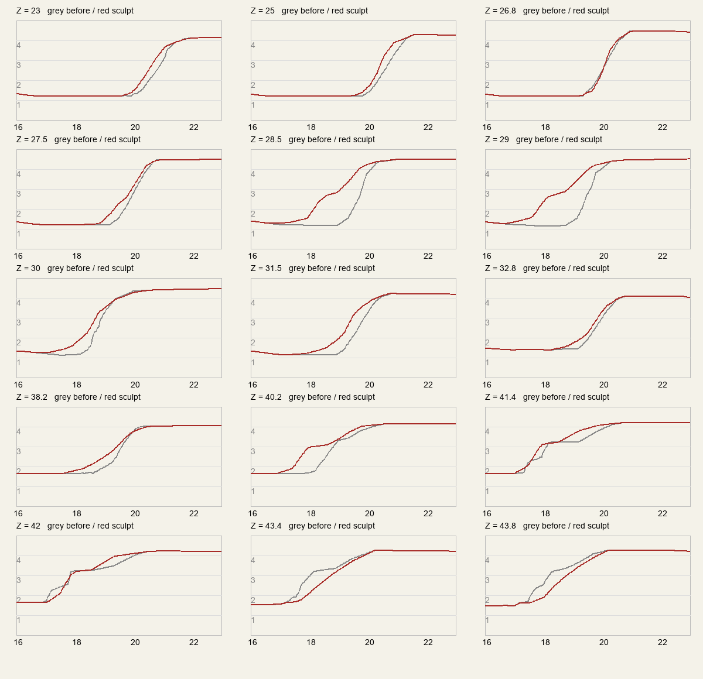
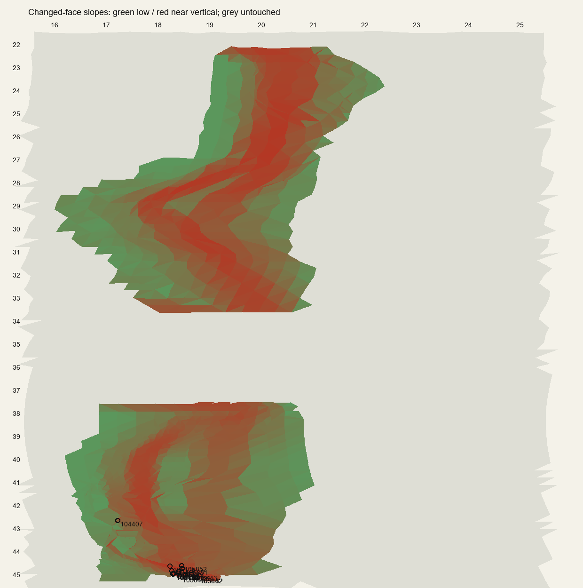

# 第一轮真实改形后的只读坡度复核

读取 `cliff_contacts_20261125/baseline.npz` 和实际MCP执行后的 `sculpt.npz`。未改制作脚本或资产。

**88.603°最大值不是本轮挤出的保护边缘尖脊。** 极值面105845中心Godot X18.4248、Z45.0663、高1.6885，原坡度88.603288°，当前88.603290°，差仅约0.0000018°；其投影三角最小高0.00347米。当前最陡前列集中在Z44.6–45.12的旧细长面，其中多面仅有极小变化。所有相关点freedom=1，没有被道路／楼板保护钳住。

| 区段（只算有改变的面） | 原p95 | 当前p95 | 原最大 | 当前最大 |
|---|---:|---:|---:|---:|
| Sea Breeze后肩A | 71.12° | 73.71° | 87.18° | 76.50° |
| 医院主凸岩B | 72.72° | 70.17° | 85.98° | 76.68° |
| 酒吧后楔C | 79.54° | 66.36° | 89.72° | 85.52° |

全部改变面p95从77.94°降至69.10°。这些数字只能解释形体与风险，不能证明画面成立。

灰线为本轮基线，红线为实际改形结果。Z28.5–29形成两段宽岩面和中部肩；Z40.2–42是另一种较低中肩。图中没有出现由保护边缘产生的独立尖脊或明显新反坡；大部分变化是坡脚向海外伸，顶端仍接原路床。

新增超过75°且比原来增加超过10°的仅三面：46754、47042、47043，中心X18.42–18.60、Z28.07–28.38，原2.49–6.02°，当前75.15–76.68°。这是主凸岩北侧较急的斜转面，三点均freedom=1、weight=1，原因是Z27.5到29之间坡脚向海推进较快，而不是保护造成的夹脊。

这三面属于裸岩侧面，本身不构成必须降低坡度的通路问题。先看普通镜头实拍：若北侧读成刀切尖翼，可将Z27.5行的低段向海平缓展开约0.25–0.4米，并把Z29主凸点的低段向内收0.1–0.2米，减少沿Z方向的突变；仍保持上段宽面与固定路床。不要全局平滑，否则会抹掉本轮所需的主次与层次。未自动实施这些候选调整。

详细极值面坐标、原／新坡度、顶点和保护权重在 `cliff_sculpt_slope_review.json`。顶部极值落在本轮C段外侧淡出尾部附近，不能简单用它代表新主岩面的形状。
