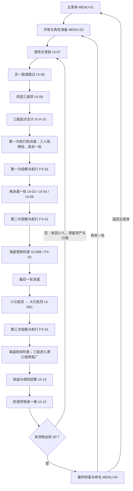

# 马尼拉：完整 UI 流程与后续制作路线

> 创建于 2026-09-14。本文件补充第一阶段之后的界面衔接与制作顺序，用于以后每次只接一个小任务。它是规划，不表示这些界面已经实现或获得用户认可。

| 文档 | 负责什么 |
| --- | --- |
| [美术与 UI 制作计划](art-ui-plan.md) | 当前任务状态、第一阶段 UI-01～04 的要求、获用户确认后的交接记录 |
| [原版规则参考](manila-rules.md) | 规则顺序、数值、特殊情况，以及项目改动和待定事项 |
| 本文件 | 完整对局的 UI 入口与出口、后续任务的依赖、分阶段制作与预览情景 |

**验收约定：先做出效果，继续调整，等用户明确表示满意后，再更新该项进度与定稿记录。** 技术检查通过只说明实现得到验证，不等于审美验收。调整期间不反复更新主计划，不自动推进下一项。

## 1. 第一阶段完成后，从哪里接

当前进度（2026-09-17）：UI-01、UI-02 已获用户验收，UI-03 进行中。用户已确认将本步改为统一派遣面板：三船、港口、修船厂、海盗、小/大引航员与保险公司一起提供选位入口；场景三船只展示已落位船员，不接受直接放置。确认扣费与真实落位仍由 UI-04 接通；这是范围调整，不是完成或外观验收。

第一阶段是 UI-01 → UI-02 → UI-03 → UI-04，目标是点通“选角色 → 个人栏 → 统一面板选岗位 → 确认派人 → 资源与场景展示同步 → 下一位行动”。四项都经用户认可后，**下一项是 UI-05：完整对局构图**。

UI-05 先把三艘船、五位玩家、行情和所有岗位占位一起摆进画面，检查全局是否清楚。随后再扩展角色/货物规格、资金面板和具体阶段界面。这能在细做所有面板之前发现地图遮挡、信息拥挤和风格不一致。

推荐的制作顺序如下，保留旧计划中的编号；编号不等于必须按数字升序施工：

| 制作阶段 | 建议顺序 | 阶段结束时能看到什么 |
| --- | --- | --- |
| 第一阶段：派人样板 | UI-01 → UI-02 → UI-03 → UI-04 | 一次可重复的派人交互 |
| 第二阶段：全局构图与信息 | UI-05 → ART-01 → ART-02 → UI-12 → UI-11 | 完整对局布局、两套角色身份、四货对应、行情与个人资产 |
| 第三阶段：岗位事件与结果 | UI-06A → UI-06B → UI-06C → UI-06D | 在已有统一放置基础上，深化收益结果、海盗决策、引航位移及保险责任 |
| 第四阶段：航程准备 | UI-07 → UI-08 → UI-09 → UI-10 | 从竞拍港务长到三船准备出航的一条流程 |
| 第五阶段：航行与结算 | FX-01 → FX-02 → UI-13 → MENU-04 | 一次航程能演示到结算，再进入下一航程或终局 |
| 第六阶段：开局入口与素材补齐 | MENU-01 → MENU-02 → MENU-03 → ART-03 | 从主菜单进入一局，暂停、返回与再开一局，逐批补全美术 |

这里的“第二阶段”等是**制作阶段**，与游戏内的“第二次航行”无关。每个制作阶段仍拆成多次小任务，不在一次对话里全部完成。未接通的上下游先用可重置的固定场景演示。

## 2. 整局复用的界面骨架

尽量在同一个海港主场景里切换当前操作，只在主菜单、开局准备和最终结果时使用大幅页面变化。具体面板位置由 UI-05 的实际构图决定，以下先确定职责。

| 区域 | 常驻内容 | 后续怎样复用 |
| --- | --- | --- |
| 紧凑阶段提示（个人栏上方） | 当前阶段、派遣轮或航行次数；他人担任港务长时显示姓名与相对座次 | UI-02 贯穿竞拍、派人、海盗、引航与结算；不重复显示航程，不常驻五人顶部卡片 |
| 底部个人栏 | 当前操作者的头像、现金、可用小人、背面持股；航程；本人担任港务长时的头像弧形标记 | 换操作者同步整套个人数据并盖回股票；UI-11 后续扩展资产操作；公共行情不随换人改变 |
| 海港棋盘 | 三船、航线、已确认上船的人物与航行结果 | 船只只负责展示，不提供派遣点击或未确认人物预览；由统一占用数据同步，供 FX-01/02 演出使用 |
| 统一派遣面板 | 可展开/收起的三船座位、港口、修船厂、海盗、小/大引航员与保险公司图示，费用与占用 | UI-03 提供所有岗位选择，UI-04 接通确认与资源更新；UI-06 只深化各岗位后续事件和结果，不另造放置入口 |
| 公共行情 | 四货物图标、当前行情、本航程是否装载 | UI-12 替换 UI-05 的占位，供买股、装货和结算参考 |
| 当前操作面板 | 当前目标、规则提示、费用/效果、确认/取消/放弃 | UI-04 的交互与按钮样式供岗位、引航、竞拍等复用；各阶段内容单独做 |
| 结果与通知 | 得标、扣费、登船、到港、损坏、收入与涨价 | 轻量反馈配合 UI-13 明细；同一结果不重复发钱或扣款 |

当前样板按用户批准的**同屏轮流操作**方向制作：底栏属于当前操作者，换人时头像、现金、小人和持股整套切换，公共行情不变。股票默认背面，操作者点击单张查看；换人、隐藏界面、失焦及结算时盖回，结算时禁止翻牌。同屏翻牌仍需其他人避看，不等于身份认证。港务长独立于行动人：本人担任时在头像左侧标记，否则显示其姓名和“下家／后 N 位”。联网客户端的本地身份与查看权限以后另行设计。

角色只承担形象和身份，没有已确定的专属技能。本轮规划不增加技能栏。玩家身份标记与货物标记分别设计，不能用同一种颜色同时表达“谁的小人”和“什么货物”。

## 3. 真正玩一局时，界面如何相接



图中的海盗与引航是检查点，只有对应岗位和条件满足才出现交互，没有事件则直接继续。派遣轮计数按[规则 R03](manila-rules.md#r03)，不能把三人局写成四次投骰。

### 各界面的入口、操作人与出口

| 入口与界面 | 谁能操作，主要看到什么 | 确认、取消与退出后的去向 |
| --- | --- | --- |
| 主菜单 → 开局准备（MENU-01/02） | 设置 3–5 人、玩家席位和角色；沿用现有选角流程 | 准备完成进入首航竞拍；取消开局返回主菜单。初始两张股票可从个人资产查看 |
| 每航程开始 → 竞拍（UI-07） | 当前竞拍者看当前最高价、自己的可支付金额、加价与退出；其他玩家看进度 | 出价后轮到下一位；退出后本次不能重入。得标支付后显示新港务长，进入 UI-08 |
| 得标 → 买股（UI-08） | 只有港务长选购；展示四货库存、行情及实际买价 | 购买一张或跳过均进入 UI-09；确认购买前可改选或取消选择，成交后不以“返回”退钱 |
| 买股结束 → 装货（UI-09） | 港务长四选三，并看三船与货物的对应 | 下一步进入 UI-10；未确认的装货选择属于准备草稿，可调整 |
| 装货完成 → 起点（UI-10） | 港务长调整各船 0–5 起点，查看合计和剩余需分配点数 | 合计 9 才能最终确认；可返回 UI-09 调整准备草稿。最终确认后锁定货物与起点，进入派遣 |
| 轮到自己派遣 → 统一面板与确认（UI-03/04） | 在同一面板选择任意合法岗位，显示归属、费用、人数变化和岗位作用；场景船不可直接放人 | 取消或收起只撤销未提交选择；确认后扣费/放人并同步场景、切换行动人；“本航程不再派遣”单独明确确认，不能等同于关闭面板 |
| 一轮派遣结束 → 投骰航行（FX-01） | 港务长投骰入口；所有人看到骰子与对应船移动 | 运动结束回到正确的下一轮派遣或事件检查。已到港船不再进入可动目标 |
| 第二次航行后船停 13 → 登船（UI-06B、FX-02） | 当前海盗先后选择目标或留守；其他人看目标与归属 | 船长先处理，再处理次席；确认才落位、更新船长。两席处理完返回最后一轮派遣 |
| 最后一轮派遣结束 → 引航（UI-06C） | 小引航员先选船和方向，大引航员后操作 | 修改/取消仅影响自己的未提交预览；确认或放弃后交给下一位引航员，最终进入第三次投骰 |
| 第三次航行后船停 13 → 劫掠（UI-06B、FX-02） | 清楚展示谁被移回、谁参与劫掠；由海盗船长逐船选港口或修船厂 | 船去向确认后锁定，全部归位才进入 UI-13。无人留守海盗船时，13 号位船正常到港 |
| 三船去向确定 → 航程结算（UI-13） | 各收益来源、失败原因、保险付款方与收款方 | 普通明细可折叠；必须完成的保险付款不能用关闭面板跳过。结清后播放涨价反馈 |
| 结算结束 → 行情（UI-12） | 到港货物从旧刻度到新刻度；未到港货物保持不变 | 未达 30，显示“下一航程”并回竞拍；达到 30，进入 MENU-04 |
| 整局结束 → 最终结果（MENU-04） | 角色排名、现金、股值、债务扣除与总财富 | 再来一局 → MENU-02；返回主菜单 → MENU-01 |
| 底栏/付款入口 → 个人资产（UI-11） | 查看自己的持股、抵押、借款与赎回；保护对手隐藏信息 | 完成或关闭后回到打开它的界面，并保留未提交的出价、派遣或付款上下文 |
| 局内设置入口 → 暂停/设置（MENU-03） | 继续、音量、显示选项和返回主菜单 | 继续回原界面；返回主菜单需说明会离开当前对局。联网模式的“暂停”语义以后确定 |

上述“返回”是 UI 衔接设计：未提交的选择可改，已经发生的出价退出、购买、派遣、引航等结果不能靠关窗倒退。开发预览的重置能力放在单独预览入口，不混入正式游戏操作。

### 资金面板是插入步骤，不能打断原流程

```text
竞拍 / 买股 / 派遣 / 保险付款
    → 打开自己的 UI-11（保留原目标、当前金额和行动人）
    → 选择抵押或赎回，确认后更新现金与股票状态
    → 返回原操作，按新资金重新检查是否可执行
```

- 打开面板不自动借款；借款已确认后，关闭面板不撤销该笔贷款。
- 从派遣返回时仍选着原位置，但必须重新确认其合法性；不重复放人、不重复扣费。
- 报价上限考虑现金和可取得的贷款；不能仅因眼前现金不足就把合法报价永久禁用。
- 保险不足时，明确显示必须补足的金额、可借额度和银行最终补足额；不能用“取消”消除付款义务。
- 贫困登船依[规则 R09](manila-rules.md#r09)处理，不能把所有无钱状态都设计成不可操作，也不能把所有岗位改成免费。

## 4. 第二阶段：完整构图与信息样板

前提：第一阶段四项已获用户认可。目标：在一张完整对局画面中确定整体风格、信息优先级及复用规格。

| 子任务 | 本次具体做什么 | 接到哪里、重点看什么 |
| --- | --- | --- |
| **UI-05：完整对局构图** | 三船、五位玩家的身份标记、紧凑阶段提示与个人栏、四货行情占位、全部岗位占位同时出现；加入三船位置摘要或快速定位样板 | 接在 UI-04 后，先不扩展规则。检查地图左右移动、弹窗遮挡、拥挤状态和较小桌面窗口；用户认可后再记录字体、颜色、年代感与像素规格 |
| **ART-01：两套角色身份** | 先做拉坎，再做一位轮廓差异明显的角色；各有角色卡裁切、小头像、小人、徽记与辅助色 | 替换混坐船位与个人栏的占位，确认小尺寸可辨；其余角色等规格稳定后补齐 |
| **ART-02：四货视觉对应** | 人参、肉豆蔻、丝绸、玉石各制作图标，并用于船货、骰子标识、股票和行情 | 同货在不同 UI 一致；货物与玩家身份不混淆；按 [R02](manila-rules.md#r02)检查容量与收益表达 |
| **UI-12：公共行情板** | 替换占位，显示四条 0/5/10/20/30 刻度、当前值、装载状态和涨价样例 | 可先常驻摘要、展开看完整板；不展示对手秘密持股。后续供 UI-08/09/13 使用 |
| **UI-11：个人股票与资金** | 从个人栏进入，显示自己的持股、股值、未抵押/已抵押状态、借款 12/赎回 15 与确认反馈 | 第一次先做资产查看，第二次再做借还款与返回原操作；其余面板可暂用固定“返回到出价/派遣”入口 |

阶段验收：全局五人可读；两种角色在同船可辨；四货在全部媒介可对应；资产面板能打开和返回；用户认可整体观感。具体尺寸和头像裁切在验收前仍可改，不提前写成定稿。

## 5. 第三阶段：深化岗位事件与结果

前提：UI-03/04 已完成统一面板内所有岗位的选择与确认派驻，UI-05 的全局空间和身份/货物表现可复用。本阶段只深化特殊岗位后续操作与结果，不推迟或重复制作基本放置入口；事件时间先由固定预览切换，正式航行稍后接入。

| 子任务 | 本次具体做什么 | 入口、出口与预览重点 |
| --- | --- | --- |
| **UI-06A：港口与修船厂结果** | 复用两组 A/B/C 岗位，补预期收入及实际有船/无船、成功/失败状态 | 从统一面板查看结果，预览 0–3 艘到达组合，讲清 A/B/C 对应数量，不绑定货物 |
| **UI-06B：海盗决策** | 复用两席与派驻，补船长交接、第二航行后“登船/留守”、第三航行后“送港口/修船厂” | 分别做登船选择与劫掠去向，返回派遣或结算准备；FX-02 后补演出 |
| **UI-06C：引航员位移预览** | 复用小/大岗位，补选船、前后箭头、移动格数和最终船位预览；确认/取消/放弃 | 建议先小引航，再大引航。小先大后，最终回第三次投骰；取消不移动船，已到港船不可选 |
| **UI-06D：保险责任与赔付** | 复用免费派驻、立即 +10 与已投保状态，深化可能赔付的说明 | 结算预留 UI-13 入口。把“此前已领钱”与“最后赔付”分开，不重复发收入，也不能写成无风险收益 |

每个岗位都要有空位、悬停、已选、已占、不可用和结果状态。不需要各造一套按钮/弹窗；不同之处主要在图标、目标和解释内容。特殊规则看 [R05～R10](manila-rules.md#r05)。

阶段验收：玩家能回答“这里花多少钱、谁已占用、可能得到什么、现在确认会发生什么”；海盗船长、港务长、引航员不会被误认为角色技能。

## 6. 第四阶段：接通航程开始的准备流程

前提：UI-02/05 的全局信息、ART-02 的货物、UI-11/12 的资金与行情。按[规则 R04](manila-rules.md#r04)依次推进。

| 子任务 | 本次具体做什么 | 需要的状态与出口 |
| --- | --- | --- |
| **UI-07：港务长竞拍** | 当前最高价、报价人、轮到谁、加价、退出、得标；连接借款入口 | 先做报价/退出/等待/得标，再补资金不足与借款返回。退出不能重入，未中标不扣报价；得标后进入 UI-08 |
| **UI-08：港务长买股** | 四种股卡、库存、行情和最低 5 的实际售价，购买或跳过 | 库存为 0 不可买；选择可取消；成交只发生一次；非港务长等待。之后进入 UI-09 |
| **UI-09：本航程装货** | 四选三，明确未装载货物与三船映射；容量和船标随货变化 | 恰好三种才能下一步；草稿保留到 UI-10，返回可继续调整 |
| **UI-10：三船起点** | 0–5 拖动或加减预览，合计显示、合法提示和最终确认 | 3/3/3、5/4/0 可确认；超界或合计非 9 不可确认；提交后进入派遣第 1 轮 |

阶段验收：固定数据可以从竞拍连续走到第一次派遣；等待者能理解正在发生什么；返回/取消不重复付款，起点不合法时原因明确。

首航全员弃标和第一出价者的电子版处理仍见[待定事项](manila-rules.md#r12)。做常规竞拍样板无需提前决定所有房间规则，但不得将临时默认值写成原版规则。

## 7. 第五阶段：航行、特殊事件、结算与下一航程

前提：上述面板已有可认可的样板。目标是把已有 UI 接成一段完整、可重复的视觉流程；仍可使用固定骰子和固定结果，不要求此时做完整对手或网络系统。

| 子任务 | 本次具体做什么 | 拆分建议与衔接 |
| --- | --- | --- |
| **FX-01：投骰与航行** | 当前航行次数、对应货物骰子、结果停留、三船移动、到港和受损反馈 | 先做“一次投骰 → 对应船移动”，再补到港/受损和镜头。移动顺序按港务长的规则权限处理，预览可固定；不让演出途中重复提交动作 |
| **FX-02：海盗演出** | 使用 UI-06B 已确认的结果，表现登船换位、船长交接、劫掠退人和船去向 | 第二次后的登船与第三次后的劫掠分两个预览；不重做一套决策面板，不提前或重复发劫掠收益 |
| **UI-13：航程结算** | 船员分红、港口/修船厂收入、海盗分红、零收益原因、保险收支、现金变化和行情上涨 | 拆成普通收益、保险/贷款、涨价与下一航程三次；结清才结束本航程；复用 UI-11/12 |
| **MENU-04：最终结果** | 达 30 的终局提示、角色排名、现金 + 股值 − 债务 = 总财富，冠军表现和再来一局 | 从 UI-13/12 进入；再来一局返回准备页。平局先保留并列展示样板，不捏造原版决胜条款 |

UI-13 的账目要区分“本次结算新发放”和“本航程此前已经发生”：派遣成本、竞拍支付、买股、保险初领 10 都不能结算时再执行一次。若显示整航程净变化，要将这些旧记录作为明细，而不是再次扣发。

下一航程要收回小人、清空岗位、重新准备船货；保留现金、股票、抵押与行情。未终局时，上一任港务长发起下一轮竞拍。不要把“下一航程”接成“重新开局”。

阶段验收：至少分别走通普通航程、含海盗/引航事件的航程、需要保险借款的航程、触发终局的航程。三人局与五人局的派遣计数都正确；这些路径的视觉效果经用户确认后才记录完成。

## 8. 第六阶段：从菜单进入游戏，并补齐素材

局内风格确认后再用同一语言制作主菜单，避免菜单先定出另一种美术风格。

| 子任务 | 本次具体做什么 | 衔接与范围 |
| --- | --- | --- |
| **MENU-01：主菜单** | 标题、海港背景、开始游戏、设置、退出及选中反馈 | 开始进入 MENU-02；设置复用 MENU-03。这里只做当前项目能提供的入口 |
| **MENU-02：开局与角色准备** | 3–5 人席位、选角占用、准备状态、开始条件；复用现有六张卡的选择流程 | 准备完进入首航竞拍，角色只影响身份与画面。联网、AI 和同机隐私交接按后续选定模式接入 |
| **MENU-03：暂停与基础设置** | 继续、音量、显示、返回主菜单及必要离局确认 | 关闭回原界面；控件应与实际支持能力一致。没有接通的选项明确作为预览，不表现成已经保存成功 |
| **ART-03：剩余素材** | 根据已认可规格列缺口，补其他角色头像/小人、岗位图、货物细节和必要场景装饰 | 一次只做一位角色或一类素材；每批放回真实界面检查，不一次性批量定稿所有资产 |

阶段验收：从主菜单进入、完成准备、体验一航程、暂停继续、返回或再开一局的入口一致；剩余素材按已确认规格替换占位。

## 9. 提前保留的规则预览情景

每项制作只跑相关情景。用固定数据直接跳到场景，避免每次为看一个面板手动玩完整局；不要求将全部视觉情景写成自动化测试。

| 情景 | 最少需要看到什么 | 对应任务 |
| --- | --- | --- |
| 五人满员与较小窗口 | 当前行动人及其个人资源、港务长可辨；长姓名、金币和三船摘要不互相挤压，换人后股票盖回 | UI-02/05 |
| 三人局 | 每人 4 小人，第一次航行前两轮派遣，全航程仍只有三次航行 | UI-01/02、FX-01 |
| 同船混坐与不同容量 | 三座和玉石四座；同玩家多个小人、两玩家同船；只能选最便宜空座 | ART-01/02、UI-03/04 |
| 派遣失败与放弃 | 位置已占、无小人、已到港、已放弃本航程；取消不扣款；贫困可登船时有清楚入口 | UI-04/06、UI-11 |
| 竞拍借款再返回 | 现金 2、1 张可抵押股，最大可支付 14；借款后能继续原报价，15 的报价不可提交 | UI-07/11 |
| 装货与起点草稿 | 四选三、回退保留；3/3/3 合法，5/5/0 合计 10 不合法；最终提交一次 | UI-09/10 |
| 第二次航行后的海盗 | 13 号位有空座/满座；船长登船/留守；次席晋升；多目标选择 | UI-06B、FX-02 |
| 第三次航行后的海盗 | 有人留守则劫掠，无人则正常到港；选择港口/修船厂改变后续岗位与行情 | UI-06B、FX-02、UI-13 |
| 引航前后 | 从 12 移到 13 不立即遇海盗，从 13 移到 14 到港；大引航可改单船两格或两船各一格 | UI-06C、FX-01 |
| 运输分红 | 玉石 36，甲 2 小人、乙 1 小人：甲 24、乙 12；失败/被劫掠原船员为 0 | UI-13 |
| 保险赔付与兜底 | 两船受损责任共 14；即使无人占修船厂也付。若结算可用现金 1、仅一张可抵押股，借 12 后仍差 1，由银行补足，不额外形成债务 | UI-06D、UI-11/13 |
| 下一航程与终局 | 普通上涨后回竞拍；20 → 30 转终局；抵押股按股值计入，再扣每笔 15 | UI-12/13、MENU-04 |

## 10. 后续开新对话时怎样接手

先读主计划的当前任务与最近一次获确认的交接记录，再读本文件的对应制作阶段，最后只查相关规则章节和工程文件。无需每次把全部历史塞进上下文。

可直接使用：

> 请阅读 `docs/art-ui-plan.md` 的当前状态，以及 `docs/ui-flow-roadmap.md` 中任务【编号】的范围和入口/出口，再查 `docs/manila-rules.md` 的相关规则。本次只做该任务的一小段可预览内容，完成相关检查后给我看效果。我明确满意之前，不更新进度或美术定稿记录，不自动进入下一项。

第一阶段全部验收后，可使用：

> 开始 UI-05：完整对局构图。复用已确认的个人栏、紧凑阶段提示、船位与派遣确认，放入三船、五人、行情及全部岗位占位，让我先看完整画面。其余岗位交互以后按子任务接入，效果满意后再更新文档。

若一个主任务仍太大，用“UI-06B／登船选择”“UI-13／保险结算”这样的范围继续拆，不重编已有任务号。主任务在其全部必要部分获确认后再记完成。

只需要提前留好的通用信息是：当前操作者及其个人数据、港务长，独立的航程/派遣轮/航行计数，以及操作面板的目标和返回位置。同屏样板按换人盖牌处理；联网本地身份与权限以后确定。现阶段无需为了这些 UI 搭建完整网络、AI 或角色技能系统。
